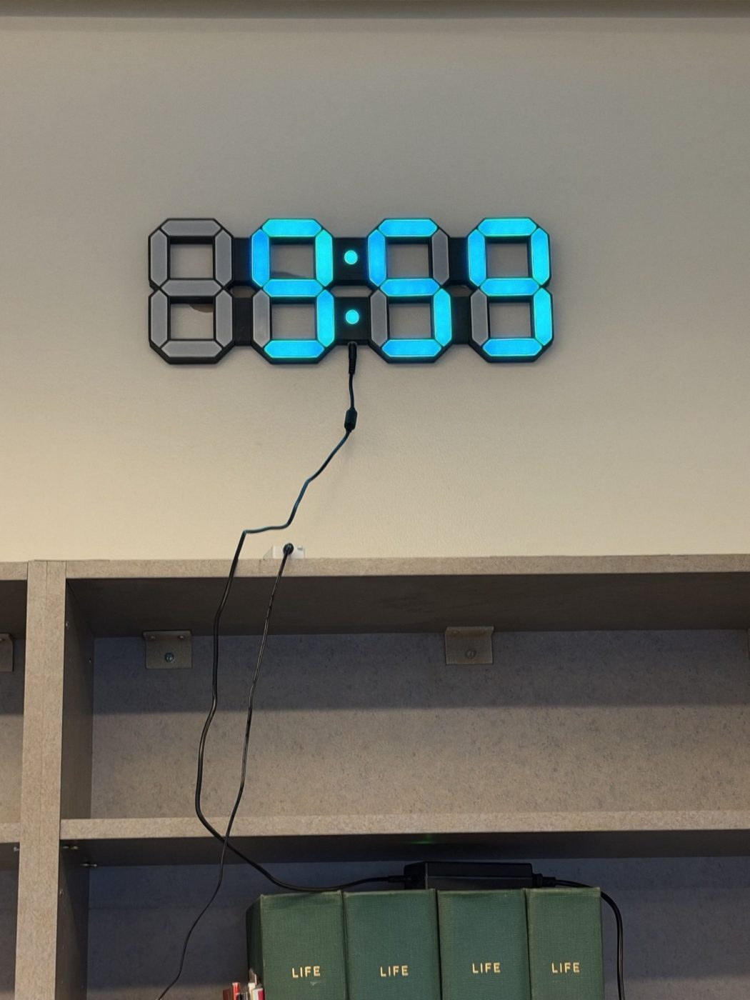
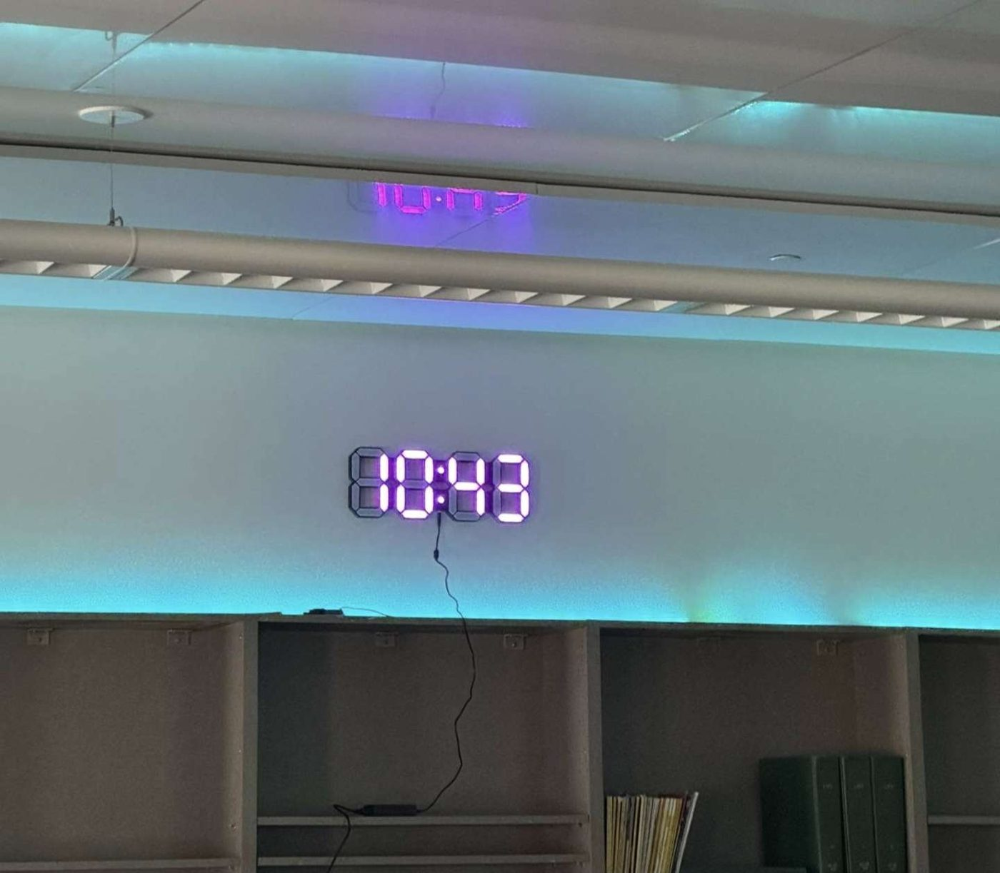
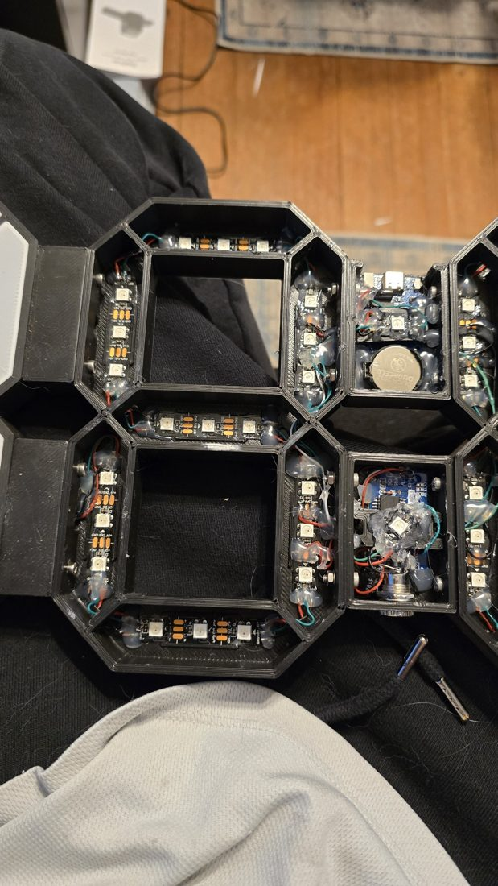
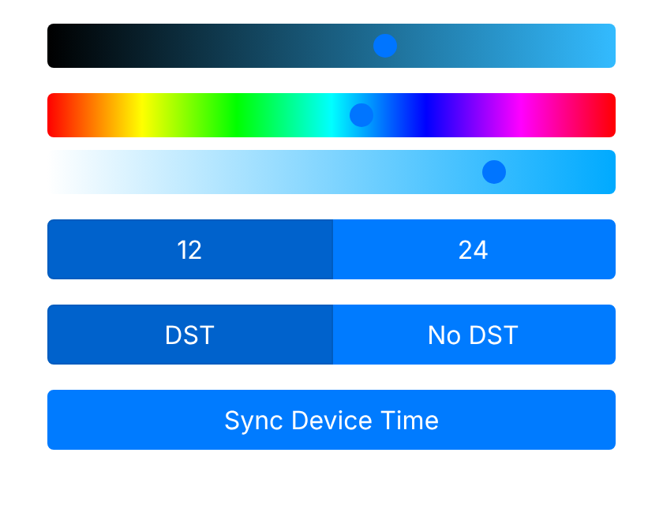
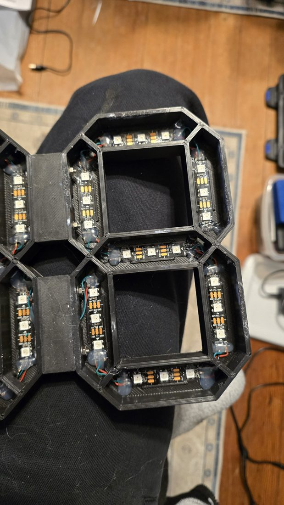
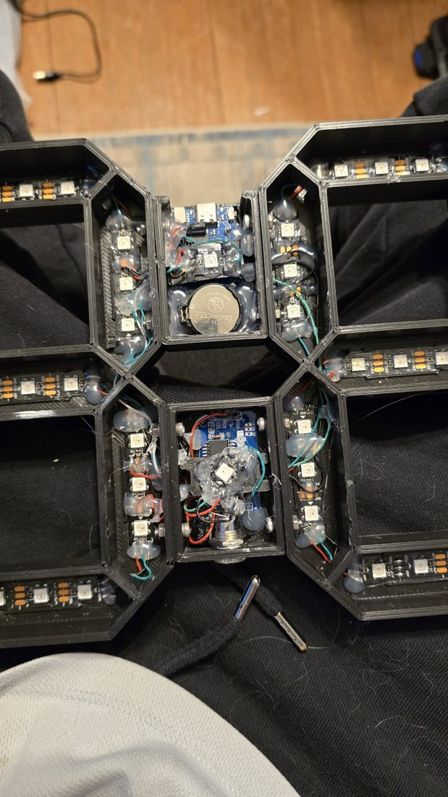
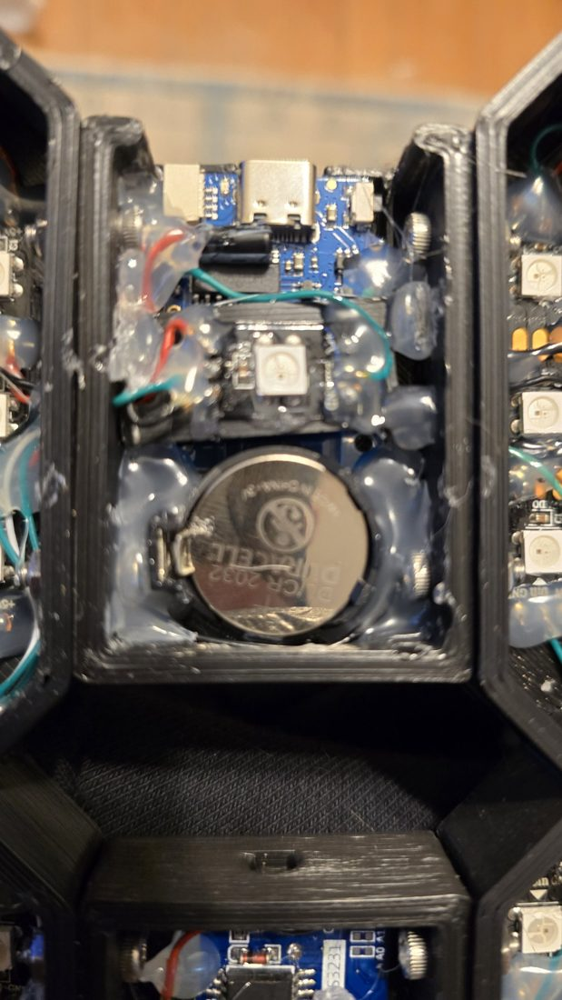

# 7-Segment LED Clock

A large wall or desk clock with four 7-segment digits built from addressable RGB LEDs, driven by an ESP8266. A DS3231 real-time clock keeps the time. The clock runs its own Wi-Fi hotspot with a small web page for setting the colour, brightness, 12/24-hour mode and daylight saving, and for syncing the time from your phone.

| Installed | Building it |
|---|---|
|  |  |
| Mounted above a shelf, running in purple. Unused segments stay dark, so the leading digit disappears before 10:00. | From the back: the 3D-printed digit housings with the LED strips glued in, and the centre module holding the electronics. More in [How it's built](#how-its-built). |

## Features

- **Colour and brightness:** set them from the web page. Changes fade smoothly into place.
- **Settings survive power cuts:** colour, 12/24-hour mode and DST are saved to the ESP8266's flash (LittleFS). To limit flash wear, a colour change is only saved after it has stayed put for 15 seconds.
- **Keeps time with no network:** the DS3231 RTC holds the time, so it doesn't need the internet.
- **Daylight saving:** applies US rules (second Sunday in March to first Sunday in November), and can be turned off.
- **One-tap time sync:** "Sync Device Time" sends your phone's current time to the clock.
- **Fade-in on power-up.**
- **Network discovery:** the clock announces itself over SSDP as "LED Clock".

## Settings page

To open it:
1. Join the clock's Wi-Fi hotspot.
2. Browse to `http://192.168.4.1/`, the ESP8266's default hotspot address.

The page has three sliders (brightness, hue and saturation), the 12/24-hour and DST toggles, and the sync button.

## Hardware

| Part | Notes |
|---|---|
| ESP8266 board (e.g. Wemos D1 mini / NodeMCU) | |
| WS2812B (NeoPixel) LEDs | **3 per segment**, wired as two strips: |
| | - Hours strip on **GPIO 2** (D4): 1 colon LED + 2 digits = 43 LEDs |
| | - Minutes strip on **GPIO 13** (D7): 1 colon LED + 2 digits, sized for 45 LEDs |
| DS3231 RTC module | I²C on the default pins: SDA = GPIO 4 (D2), SCL = GPIO 5 (D1) |
| 5 V power supply | Sized for the LEDs at your chosen brightness |

Each digit is 7 segments × 3 LEDs. The segment order inside each digit is set by the `displayHourDigit…` / `displayMinuteDigit…` functions in `src/main.cpp`.

## How it's built

Each digit is a 3D-printed frame of seven segment pockets. Short pieces of WS2812B strip (3 LEDs per segment) are hot-glued along the walls of each pocket and wired in series. Between the hours and the minutes sit two small colon modules, each with one WS2812 LED for its dot. They also house the electronics: the USB-C controller board and the DS3231 RTC with its CR2032 backup cell. Power comes in through a DC jack under the centre.

| | |
|---|---|
|  |  |
| One digit from the back: 3 LEDs on each wall, hot-glued in place | The colon modules between the digits, with the controller board and RTC |
|  | |
| Close-up: the USB-C controller board, the colon LED and the RTC's CR2032 cell | |

## Building

This is a [PlatformIO](https://platformio.org/) project; the VS Code extension is the easiest way to use it. `platformio.ini` pins the board and library versions:

| Library | Version | Why pinned |
|---|---|---|
| FastLED | 3.6.0 | Tested version |
| ArduinoJson | 5.13.4 | The code uses the ArduinoJson v5 API |
| DS3231 by NorthernWidget | 1.2.0 | |

1. Copy `include/secrets.example.h` to `include/secrets.h`, then set the hotspot name and password (8+ characters). `secrets.h` is git-ignored.
2. If your board is a NodeMCU rather than a Wemos D1 mini, change `board` in `platformio.ini` to `nodemcuv2`. The GPIO pins are the same.
3. Run `pio run -t upload` to flash the firmware.
4. Run `pio run -t uploadfs` to upload `data/` (the settings page and default `config.json`) to LittleFS.

## Files

| Path | Purpose |
|---|---|
| `platformio.ini` | Board, filesystem and pinned libraries |
| `src/main.cpp` | Firmware: LEDs, RTC, DST, web server, settings storage |
| `data/index.html` | Settings page, served from LittleFS (Bootstrap is inlined, so it works offline) |
| `data/config.json` | Default settings |
| `include/secrets.example.h` | Template for the hotspot name and password |

## Web API

The settings page uses these endpoints, which you can also call directly:

| Method & path | Body / query | Does |
|---|---|---|
| `GET /config` | | Current colour, 12/24 mode |
| `PUT /color` | `?h=0-360&s=0-100&v=0-100` | Fade to a new colour |
| `GET`/`PUT /clock` | `12` or `24` | 12/24-hour mode |
| `GET`/`PUT /dst` | `1` or `0` | DST on/off |
| `PUT /time` | `?year&month&day&dow&hour&min&sec` | Set the RTC |

## Known issues

- The DST start and end dates are worked out from *today's* day of the week, not from the weekday of March 1 and November 1. So the switch can happen on the wrong day in some years.
- In 24-hour mode, during DST, the hour after 23:59 can show as `24` instead of `00`.
